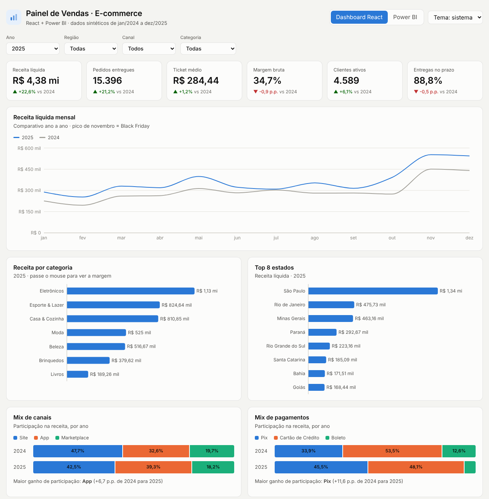
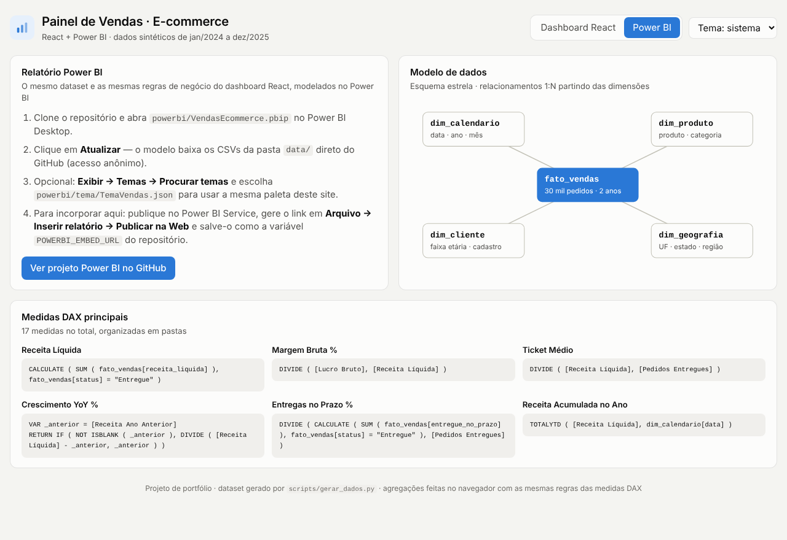

# Painel de Vendas · E-commerce — React + Power BI


Projeto de portfólio de **análise de dados de ponta a ponta** para um e-commerce brasileiro fictício:
geração do dataset em Python, modelagem dimensional, medidas DAX no **Power BI** e um **dashboard web em React**
que aplica as mesmas regras de negócio no navegador.

**🔗 Demo ao vivo:** https://jvcsampaio.github.io/ecommerce-analytics-react-powerbi/

[](https://github.com/JVCSampaio/ecommerce-analytics-react-powerbi/actions/workflows/ci.yml)

**Pergunta de negócio:** como evoluíram as vendas, a margem e a operação do e-commerce entre 2024 e 2025?
O dashboard permite explorar esses indicadores por ano, região, canal e categoria.
Os dados são sintéticos: os resultados ilustram a análise de um cenário de varejo, sem representar uma empresa real.



---

## O que tem aqui

| Camada | O que faz | Onde |
|---|---|---|
| **Dados** | Gera ~30 mil pedidos (jan/2024 → dez/2025) com sazonalidade real do varejo: Black Friday, Natal, Dia das Mães, crescimento ano a ano, migração para App e Pix | `scripts/gerar_dados.py` → `data/*.csv` |
| **Power BI** | Modelo estrela com 4 dimensões, 17 medidas DAX (inteligência de tempo, margens, logística) e relatório de 2 páginas — tudo em **PBIP/TMDL** (texto, versionável no Git) | `powerbi/` |
| **React** | Dashboard interativo com filtros, KPIs com variação vs ano anterior, comparativo mensal, mix de canais/pagamentos e ranking de produtos; tema claro/escuro | `web/` |
| **Deploy** | Build estático do React publicado no GitHub Pages direto da pasta `docs/` | `docs/` |

## Destaques técnicos

- **Uma base de dados, duas camadas de BI.** As medidas DAX e a agregação do React usam as mesmas definições: receita de pedidos entregues, margem bruta, ticket médio e entregas no prazo. A validação automatizada confere a equivalência dos CSVs com o JSON e as agregações do React. A execução das medidas no Power BI Desktop é uma verificação separada.
- **Power BI como código.** O projeto usa o formato **PBIP** com modelo semântico em **TMDL**, gerado por script (`scripts/gerar_pbip.py`). Diffs legíveis no Git, sem `.pbix` binário.
- **Dados lidos direto do GitHub.** O parâmetro `UrlBaseDados` aponta para os CSVs deste repositório; basta clonar, abrir e atualizar.
- **Agregação no navegador.** O React carrega um JSON colunar compacto (~1 MB, valores em centavos inteiros) e agrega 30 mil linhas em uma única passada a cada mudança de filtro.
- **Leitura visual.** Paleta categórica compartilhada entre React e Power BI (`powerbi/tema/TemaVendas.json`), setas e cores nos KPIs, rótulos nos filtros e temas claro/escuro. Não foi realizada uma auditoria formal de acessibilidade.

## Modelo de dados

```
                 dim_calendario            dim_produto
                 (data, ano, mês)          (produto, categoria)
                          \                 /
                           \  1:N     1:N  /
                             fato_vendas
                       (30 mil pedidos · 17 colunas)
                           /  1:N     1:N  \
                          /                 \
                 dim_cliente               dim_geografia
                 (faixa etária)            (UF, estado, região)
```

### Medidas DAX (seleção)

```dax
Receita Líquida =
CALCULATE ( SUM ( fato_vendas[receita_liquida] ), fato_vendas[status] = "Entregue" )

Margem Bruta % = DIVIDE ( [Lucro Bruto], [Receita Líquida] )

Ticket Médio = DIVIDE ( [Receita Líquida], [Pedidos Entregues] )

Crescimento YoY % =
VAR _anterior = [Receita Ano Anterior]
RETURN
    IF ( NOT ISBLANK ( _anterior ), DIVIDE ( [Receita Líquida] - _anterior, _anterior ) )

Entregas no Prazo % =
DIVIDE (
    CALCULATE ( SUM ( fato_vendas[entregue_no_prazo] ), fato_vendas[status] = "Entregue" ),
    [Pedidos Entregues]
)
```

Lista completa em [`fato_vendas.tmdl`](powerbi/VendasEcommerce.SemanticModel/definition/tables/fato_vendas.tmdl)
(pastas: Vendas, Pedidos, Clientes, Operação, Tempo).

## Principais achados (dataset 2025 vs 2024)

| Indicador | Resultado |
|---|---|
| Receita líquida | **R$ 4,38 mi**, +22,6% |
| Ticket médio | R$ 284,44, +1,2% — crescimento veio de volume, não de preço |
| Margem bruta | 34,7%, −0,9 p.p. — desconto médio subiu de 6,7% para 7,3% (mais Pix) e Eletrônicos, de margem menor, ganhou peso no mix |
| Black Friday | o dia de maior receita do ano, ~4× a média diária |
| Canais | App ganhou **+6,7 p.p.** de participação na receita |
| Pagamentos | Pix ganhou **+11,6 p.p.** (desconto de 5% no Pix) |
| Logística | Sul e Sudeste entregam no prazo > 92%; Norte fica em ~68% |
| Devoluções | Moda devolve ~2,5× mais que as demais categorias |

## Como rodar

### Dashboard React

Requisito: **Node.js 24** com npm. As dependências exatas estão em `web/package-lock.json`.

```bash
cd web
npm ci
npm run dev        # http://localhost:5173
npm run build      # gera o site em docs/ (publicado pelo GitHub Pages)
```

### Power BI

1. Abra `powerbi/VendasEcommerce.pbip` no **Power BI Desktop** (Windows).
2. Clique em **Página Inicial → Atualizar**. Se pedir credenciais para `raw.githubusercontent.com`, escolha **Anônimo**.
3. (Opcional) **Exibir → Temas → Procurar temas** e selecione `powerbi/tema/TemaVendas.json`.

O parâmetro `UrlBaseDados` recebe uma **URL HTTP**, não um caminho de pasta. Para trabalhar com os CSVs locais,
altere as consultas Power Query de `Web.Contents` para `File.Contents`, apontando para sua cópia de `data/`.

O código-fonte do Power BI é publicado neste repositório. A demo web mostra o modelo e as medidas;
um relatório interativo incorporado depende de publicação adicional no Power BI Service e configuração de `VITE_POWERBI_EMBED_URL`.

### Regerar os dados e o projeto Power BI

```bash
pip install -r requirements.txt
python scripts/gerar_dados.py      # CSVs + JSON do React (seed fixa = resultado reproduzível)
python scripts/gerar_pbip.py --url-base https://raw.githubusercontent.com/JVCSampaio/ecommerce-analytics-react-powerbi/main/data/
```

### Incorporar o relatório publicado no site (opcional)

Publique o relatório no Power BI Service e gere o link em **Arquivo → Inserir relatório → Publicar na Web**. Depois:

```bash
cd web
echo "VITE_POWERBI_EMBED_URL=<link gerado>" > .env.local
npm run build      # atualiza a pasta docs/
```

Faça commit da pasta `docs/` e a aba “Power BI” do site passa a mostrar o relatório incorporado.
Use essa opção somente com dados destinados a acesso público. Variáveis `VITE_*` ficam no código entregue ao navegador.



## Estrutura

```
├── data/                      # CSVs do modelo estrela (fonte do Power BI)
├── docs/                      # site publicado no GitHub Pages (gerado por `npm run build`)
├── powerbi/
│   ├── VendasEcommerce.pbip
│   ├── VendasEcommerce.SemanticModel/   # TMDL: tabelas, relacionamentos, medidas
│   ├── VendasEcommerce.Report/          # páginas e visuais
│   └── tema/TemaVendas.json
├── scripts/
│   ├── gerar_dados.py         # dataset sintético
│   └── gerar_pbip.py          # projeto Power BI como código
└── web/                       # React 19 + TypeScript + Vite + Recharts
    ├── public/                # vendas.json + imagens do README
    └── src/
        ├── data.ts            # carga + agregações (espelho das medidas DAX)
        ├── components/        # gráficos, KPIs, tabela, aba Power BI
        └── App.tsx
```

## Stack

Python (pandas, NumPy) · Power BI (PBIP, TMDL, DAX, Power Query M) · React 19 · TypeScript · Vite · Recharts · GitHub Pages

## Validação

```bash
python scripts/validar_dados.py   # Python 3.11+, biblioteca padrão
cd web
npm ci
npm run lint
npm test
npm run build
```

O GitHub Actions executa essas verificações e confere se `docs/` corresponde ao build do código-fonte.
Os testes cobrem receita, lucro, pedidos entregues, clientes únicos, entregas no prazo e totais dos gráficos,
com filtros individuais e combinados. A validação dos dados verifica chaves, referências e cada linha CSV/JSON.
Ela também analisa o JSON do PBIP, mas não substitui abrir, atualizar e revisar o relatório no Power BI Desktop.

## Limites da análise

- A granularidade da base é um pedido com um produto; não existe uma tabela separada de itens de pedido.
- A margem bruta considera receita e custo do produto; não representa lucro líquido após frete, impostos e despesas.
- Sazonalidade, crescimento e comportamento por canal são regras do gerador, não conclusões sobre o mercado.
- O primeiro ano não tem base para comparação anual; o indicador YoY é exibido quando há período anterior.

---

<details>
<summary><strong>English summary</strong></summary>

End-to-end analytics portfolio project for a fictional Brazilian e-commerce store: a Python-generated star-schema
dataset (~30k orders, 2024–2025, with realistic seasonality), a **Power BI** project stored as code (**PBIP/TMDL**,
17 DAX measures, 2-page report) and a **React + TypeScript** dashboard that reproduces the same business rules in
the browser. Deployed to GitHub Pages. All data is synthetic.

</details>

> Todos os dados são **sintéticos**, gerados por `scripts/gerar_dados.py`. Nenhuma empresa ou cliente real é representado.

Licença [MIT](LICENSE).
